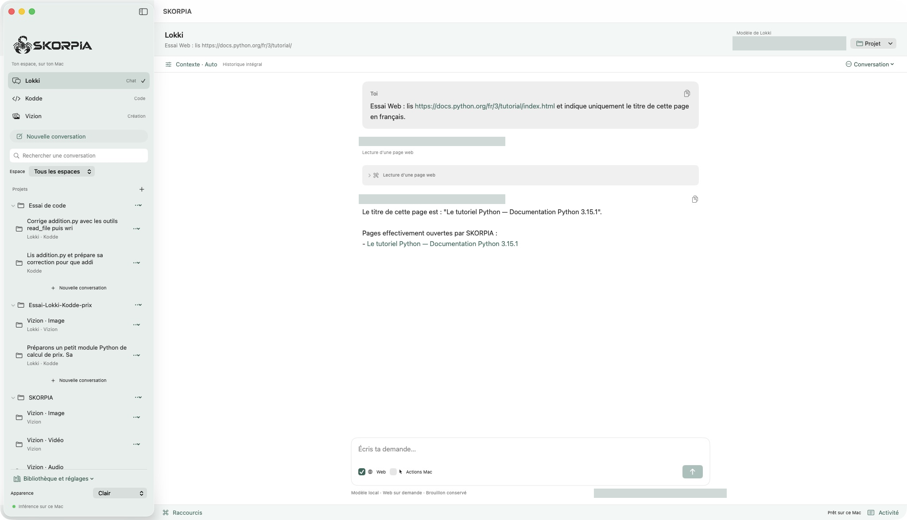
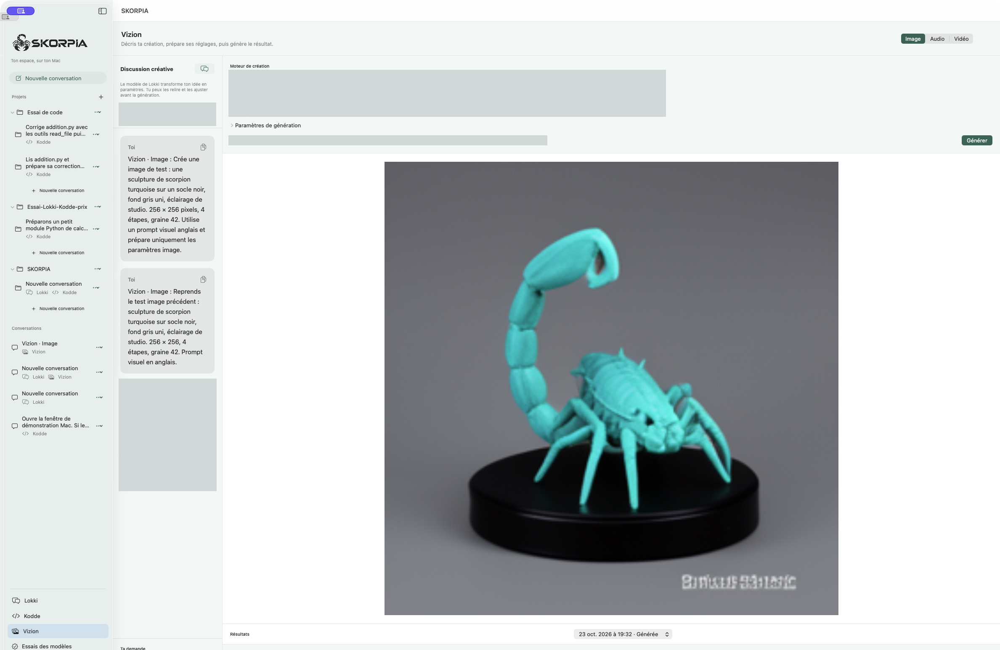

# SKORPIA

**Discuter, développer et créer avec des IA locales, dans une seule application macOS portable.**

**Version actuelle** · 0.3.14 (build 44)  
**Création du projet** · 23 octobre 2026

## Pourquoi j’ai créé SKORPIA

Je voulais pouvoir partir d’une idée, en discuter, travailler sur les fichiers d’un projet et créer un visuel ou une voix sans changer d’application à chaque étape. Chaque tâche peut bénéficier d’un modèle différent. SKORPIA réunit ces modèles dans un même espace de travail, avec la possibilité de transmettre le contexte d’un projet d’un espace à l’autre.

Je voulais aussi garder la main sur mes modèles et mes données. Je peux choisir ce qui tourne sur mon Mac et emporter mon environnement de travail avec moi.

## Trois espaces de travail

| Espace | À quoi il sert |
| --- | --- |
| **Lokki** | Poser des questions, développer une idée, travailler avec l’historique d’un projet ou consulter des pages Web publiques à la demande. |
| **Kodde** | Explorer les fichiers d’un projet, demander une modification, relire les changements et lancer des vérifications selon les autorisations choisies. |
| **Vizion** | Transformer une idée en réglages de création, puis produire des images ou des voix avec des moteurs locaux compatibles. La vidéo fait partie des usages à approfondir. |

## Local et non censuré, un choix assumé

L’inférence tourne sur le Mac avec les modèles installés. Le choix inclut des variantes dites **non censurées**, conçues pour être moins restrictives dans leurs réponses. Le comportement dépend du modèle choisi. La recherche Web et le téléchargement de modèles utilisent Internet quand ils sont sollicités.

## Un espace de travail portable

L’application et son dossier de données peuvent voyager ensemble sur une clé USB, un SSD externe ou un autre volume inscriptible. Cela permet de retrouver les modèles installés, les conversations, les projets importés et les réglages sur un Mac compatible. Les modèles peuvent occuper plusieurs gigaoctets, ce qui rend la vitesse et la capacité du support importantes.

## Captures d’écran

Les captures de développement ont été anonymisées. Les identifiants locaux et les noms des modèles et moteurs y sont masqués.

### Lokki · Conversation et lecture Web

### Vizion · Préparation d’une création

## Prochaines évolutions

- **Qualité des réponses et autonomie.** Comparer SKORPIA à BIONIC dans LM Studio, avec les mêmes modèles et les mêmes scénarios. Travailler sur la compréhension du contexte, la capacité à terminer une tâche et la reprise après une erreur.
- **Navigation dans Chrome.** Développer une extension inspirée de celle que j’ai créée pour **LAZYFAB**. SKORPIA pourrait ouvrir ses propres onglets en arrière-plan pour rechercher, lire et naviguer sur des sites externes sans perturber mes onglets personnels.
- **Recherche Web.** Améliorer le choix des sources, la vérification des liens et la clarté des réponses quand les sources disponibles sont insuffisantes.
- **Création et portabilité.** Approfondir les usages audio et vidéo, mieux guider le choix des modèles selon le matériel et étudier d’autres systèmes au-delà de macOS.

## Statut du projet

SKORPIA est un projet privé à code fermé, en développement. Ce dépôt sert de vitrine pour présenter le projet et ses captures d’écran. Le code source, l’application et les modèles restent privés.

© Fabien EphKa. Tous droits réservés sur SKORPIA.
